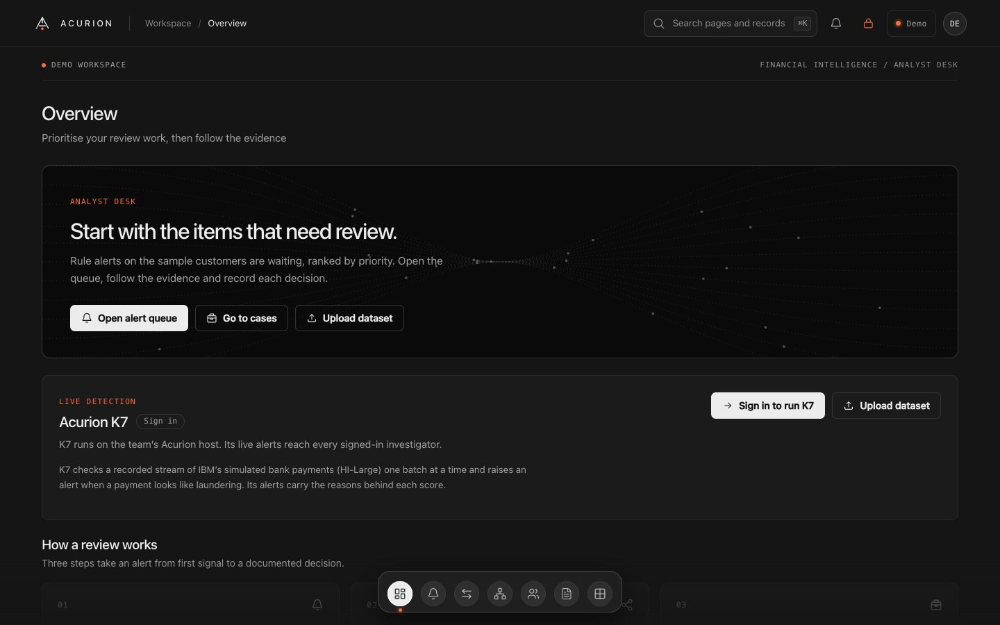

# Acurion: AML investigation workspace

Acurion ranks money-laundering alerts from **Acurion K7**, a real-time laundering model, from datasets investigators upload, and from a rules engine. It explains why each alert was raised, follows the money through connected accounts, and turns the evidence into a signed STR/SAR report with goAML XML. Case data is encrypted in the browser, every change is hash-chained, and access is role-based.

Live site: https://acurion.vercel.app



## Quick start

```sh
npm install
npm run dev
```

Open `login.html` and choose **Explore demo workspace**. No account is needed. The first page asks you to set a **workspace passphrase**; it encrypts the case workspace on that device. To build with the demo always on:

```sh
VITE_DEMO_MODE=true npm run dev
```

## Demo and signed-in workspace

| | Demo (no account) | Signed in (any verified account) |
| --- | --- | --- |
| Alerts | Rule-engine alerts on invented sample customers | Acurion K7's live alerts, alerts from uploaded datasets, and rule alerts |
| Acurion K7 | Shown, with a sign-in prompt | Start and Pause (reviewers and admins); progress and newest alerts in the header island and on Overview |
| Upload dataset | Sign-in prompt | Upload a CSV; the host scores it and adds its alerts and networks for everyone |
| Storage | Encrypted case workspace on this device | Firebase project `acurion-2bd21`; cases as one encrypted team record |

Model scores are rankings from 0 to 1, never probabilities or percentages. The case workspace starts with invented sample customers and counterparties so every feature can be shown.

## Features

| Page | What it does |
| --- | --- |
| Overview (`index.html`) | Acurion K7 live detection (Start / Pause, progress, newest alerts), queue summary, priority alerts, due-diligence tasks, transaction calendar, risk trend |
| Alerts (`alerts.html`) | List and board views, source filter (K7, each upload, rules), live updates, K7's reason contributions, analyst decision, escalation to a case |
| Transactions (`transactions.html`) | Upload dataset, uploaded datasets and their results, search and filters, record details |
| Account network (`graph.html`) | Laundering networks found in uploads (fan-in, pass-through, round trip…), neighbourhoods, dated chain tracing, evidence capture |
| Case workspace (`compliance.html`) | Customers & KYC, screening, rules & simulation, cases, policies & retention |
| Reports & audit (`reports.html`) | Signed report export, goAML XML, printable report, report verification, audit integrity check, working drafts |
| System status (`system.html`) | Platform services (K7 and upload scoring state), source checks, dataset field coverage, demo reset |
| Sign-in pages | Email, Google and GitHub sign-in, registration, verification, password reset |

Every row and card that opens a record can be clicked anywhere on it, and record panels close with ×, Escape or a click outside. The black **K7 capsule** in the header springs open into a live panel when clicked, and briefly into a notification when K7 raises an alert or your upload is analysed.

## Security

- **Encrypted case workspace:** AES-256-GCM with a PBKDF2-SHA-256 passphrase key, stored on the device in the demo or as one encrypted team record in Firebase. It auto-locks after 15 minutes idle.
- **Tamper-evident audit trail:** every change is SHA-256 hash-chained, and **Verify integrity** names the first altered event.
- **Signed reports:** packages carry a SHA-256 fingerprint and an ECDSA P-256 signature, and **Verify a report file** detects any later edit.
- **Role-based access:** every verified account is an analyst; reviewer, admin and viewer roles are enforced by `firebase/database.rules.json`.
- **No browser-to-host connection:** Start, Pause and uploads pass through Firebase rules; the backend API key never leaves the host.
- **Browser hardening:** a strict Content-Security-Policy and security headers in `vercel.json`, plus **Mask personal data** for screen sharing.

Details and known limits: [docs/SECURITY.md](docs/SECURITY.md).

## Models and the Acurion host

| Model | What it scores | Where it runs |
| --- | --- | --- |
| **Acurion K7** | A recorded stream of IBM's simulated bank payments (HI-Large), one batch at a time, with 14 days of history per account. Three averaged XGBoost models; on HI-Large validation, 90% of its alerts were laundering (precision 0.90, recall 0.40, AP 0.56) | The host computer's K7 demo desk |
| **Acurion core model** | Uploaded CSV files, any column layout | The host computer's batch API and job worker |
| **Rules engine** | The case workspace's customers and transactions | In the browser |

The models never run in the browser, and the browser never connects to the host. Commands, status, uploaded files and results all pass through Firebase. On the host, a small bridge (`host/acurion_bridge.py`) relays them to K7 and the batch API:

```
Browser ── Firebase: hostDesk, uploadJobs, uploadFiles ── host bridge ── K7 desk (127.0.0.1:8002), batch API (127.0.0.1:8000)
           Firebase: alerts, transactions, networkReviews ◄── K7 and the bridge
```

- Running the host: [docs/HOST_SETUP.md](docs/HOST_SETUP.md).
- Publishing the rules and giving presenters the reviewer role: [docs/FIREBASE_GO_LIVE.md](docs/FIREBASE_GO_LIVE.md).
- Settings and source paths: `.env.example`.
- To review the header island and the upload flow without Firebase: `VITE_DEMO_MODE=true VITE_HOST_PREVIEW=true npm run dev` (development only).

## Build and test

```sh
npm run build   # type check and production build
npm test        # 91 unit tests: access, data mapping, rules, case workflow, encryption, audit chain, host status, upload packing
python3 -m pytest host/tests   # 14 bridge tests (needs pytest and firebase-admin)
npx vite preview   # serves the build with the production security headers
```

## Project structure

| Path | Contents |
| --- | --- |
| `src/pages/` | One script per page |
| `src/lib/` | Data service, AML rules engine, case workflow, encrypted workspace store (`complianceStore.js`, `vault.js`), audit chain, report export |
| `src/components/` | Layout shell, model explanation views, lock screen, row links, custom selects, tooltips |
| `src/islands/`, `src/components/ui/` | React 19 components: navigation dock, workspace map, notifications, activity calendar, working drafts |
| `src/styles/` | Design tokens, components, shell, pages, sign-in and motion styles |
| `firebase/` | Database rules and `set_role.py` (reviewer, admin and viewer roles) |
| `host/` | The website bridge for the host computer, its Windows start file and tests |
| `scripts/` | UN sanctions list converter |
| `ml_review/` | The earlier model pipeline (XGBoost and GNN), kept for reference; Acurion K7 replaced it |

The interface is near-black monochrome with one signal-orange accent (`#ff6b35`) for focus, selection and your current place; red, amber and green carry risk and outcomes only.

## Sanctions list import

Download the UN consolidated list XML from the [UN Security Council page](https://main.un.org/securitycouncil/en/content/un-sc-consolidated-list), convert it, then import it under **Screening › Import a watchlist** and run screening:

```sh
python3 scripts/convert-un-list.py /absolute/path/consolidated.xml /absolute/path/un-list.json
```

`docs/watchlist-example.json` shows the expected fields. A no-match result does not certify a customer as clean.

## Further documentation

| Document | Covers |
| --- | --- |
| [Finance team guide](docs/Acurion%20Finance%20Team%20Website%20Guide.docx) | Every feature in plain language, the exact rule and risk logic, and what to check |
| [FIREBASE_GO_LIVE.md](docs/FIREBASE_GO_LIVE.md) | Rules, roles and checks for the signed-in workspace |
| [HOST_SETUP.md](docs/HOST_SETUP.md) | Running K7, upload scoring and the website bridge; rehearsal checklist |
| [SECURITY.md](docs/SECURITY.md) | Encryption, audit integrity, signing, access control, headers |
| [DATA_CONTRACTS.md](docs/DATA_CONTRACTS.md) | Event, alert, graph and model fields |
| [DATASET_HANDOFF.md](docs/DATASET_HANDOFF.md) | Dataset preparation and who supplies each field |
| [REPORT_ALIGNMENT.md](docs/REPORT_ALIGNMENT.md) | How features map to the project handbook |
| [PROJECT_REVIEW.md](docs/PROJECT_REVIEW.md) | Architecture, source research and cost constraints |
| [AUTH_AND_MOTION.md](docs/AUTH_AND_MOTION.md) | Sign-in provider settings and motion behaviour |
| [COMPONENT_INTEGRATION.md](docs/COMPONENT_INTEGRATION.md) | Provenance and setup of the React components |
